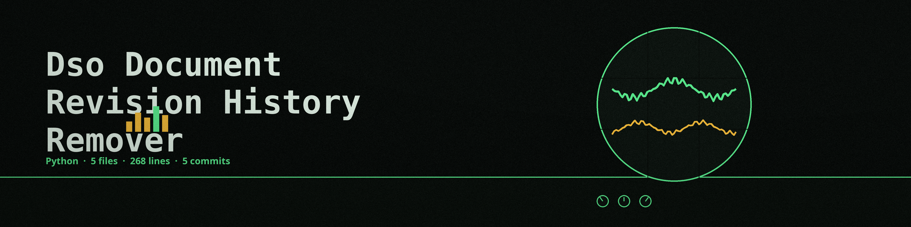

# dso-document-revision-history-remover
Removes revision history from document files (.docx, .odt) to anonymize the evolution of the document. Focused on tools for sanitizing and obfuscating sensitive data within text files and structured data formats.

## Install
`git clone https://github.com/ShadowGuard-AI/dso-document-revision-history-remover`

## Usage
`python3 main.py input.docx output.docx`
`python3 main.py input.odt output.odt`

## What it removes
- Word (.docx): tracked changes in word/document.xml are accepted. Insertions are kept as normal text, deletions are dropped with their deleted text, and any word/revisions files are removed. In docProps/core.xml the creator, the lastModifiedBy value, and the revision count are cleared.
- OpenDocument (.odt): the text:tracked-changes section and the change markers in content.xml are removed. Inserted text in the body is kept, deleted text held in the tracked changes section is dropped. In meta.xml the creator fields and the editing cycle count are cleared. styles.xml, settings.xml, and every other part are kept as they are.
- Every run logs how many items were removed.

## Exit codes
- 0: at least one revision item was removed and the output was written.
- 1: an error, an unsupported file type, a refused in place output, or a run that removed nothing. A run that removes nothing still writes an output copy, logs a plain "No revision history removed" line, and exits 1. It never claims a removal that did not happen.
- The output path must not resolve to the input file. Naming the input as the output, through the same string, a ./ alias, or a symlink, is refused at exit 1 before any write.

## Parameters
- `input_file`: Path to the input document file (docx or odt)
- `output_file`: Path to the output document file (will overwrite if exists, unless it resolves to the input file)
- `-h`: Show help message and exit
- `--log_level`: Set the logging level (default: INFO)

## License
Copyright (c) ShadowStrikeHQ
